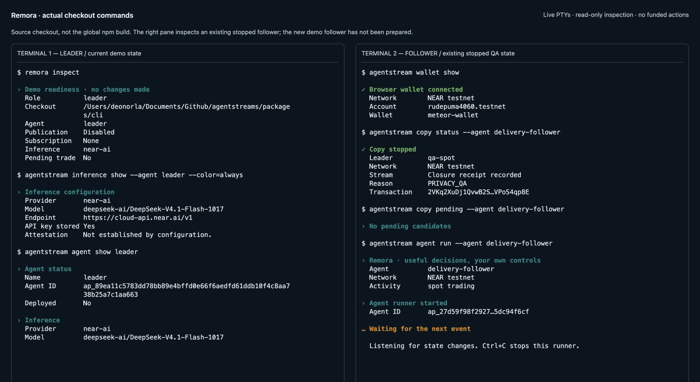
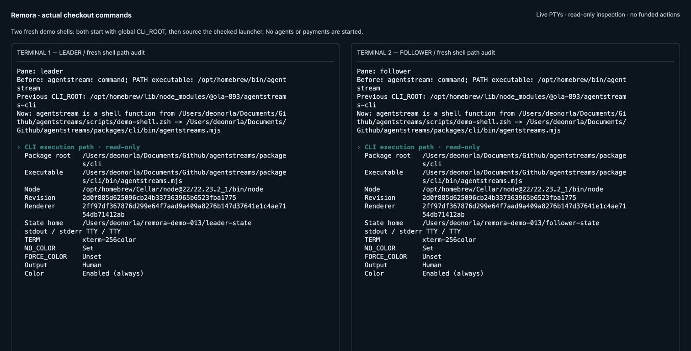

# Rehearse the CLI presentation

Useful work by one agent can benefit other agents. Streaming makes that exchange payable; guardrails let each follower use it on its own terms. The terminal now presents that story through short state changes, rather than requiring the viewer to interpret transaction objects.

This presentation pass is in the source checkout. It has **not** been published to npm. Package versions stay unchanged. No services were deployed and no funded transactions were run for this pass.

For the actual recording, start with the [short two-terminal sequence](REBALANCE_DEMO.md). It audits both shell routes and uses the checkout for every command and helper. The fixture section below is supplemental, not proof that the funded demo is ready.

## Output modes

| Invocation | Output |
| --- | --- |
| Normal interactive terminal | Concise headings, labelled facts and necessary next steps |
| Redirected or piped output | Existing structured objects and pretty-printed framing |
| `--json` | One JSON value per line; a finite command normally prints one value, a runner prints an event stream |
| `--verbose` in a terminal | Summaries plus redacted structured details |
| `NO_COLOR=1` or `TERM=dumb` | Plain status words without ANSI color; dumb terminals use ASCII heading markers |

`--help --json` and `--version --json` return JSON strings. Diagnostics remain on stderr; explicit JSON command failures use a JSON error object there and preserve exit code 1. MCP's stdio protocol is unchanged. Existing script consumers, including the distribution verifier and copy QA helpers, parse piped JSON and keep that behavior.

Private keys, API keys, authorization fields and free-form inference text are redacted in all output modes, including verbose/JSON. Structured review status and evidence references remain visible. Object field names, status identifiers, integer amount strings and evidence objects retain their schemas; redaction deliberately replaces sensitive values. A one-use browser approval URL is printed once on stderr, unwrapped, because it is needed to complete the request. Keep that URL out of shared recordings.

Amounts use decimal string/BigInt arithmetic. NEAR units, wrapped NEAR and the existing fixed USDC token IDs have pinned metadata. Unknown tokens are explicitly labelled `raw units`; the renderer does not make network calls to guess their symbols or decimals. Full IDs and receipt payloads remain available with `--json`; recipients are shown in full before wallet approval and transaction details remain in the browser wallet.

## Offline presentation rehearsal

Run these commands in your terminal, using the current source rather than the global npm installation:

```sh
cd /Users/deonorla/Documents/Github/agentstreams
NODE=/opt/homebrew/opt/node@22/bin/node
"$NODE" scripts/rehearse-cli-output.mjs --width 72
"$NODE" scripts/rehearse-cli-output.mjs --width 48 --no-delay
NO_COLOR=1 "$NODE" scripts/rehearse-cli-output.mjs --width 64 --no-delay
"$NODE" scripts/rehearse-cli-output.mjs --json --no-delay | jq -c .
```

The rehearsal is explicitly labelled **synthetic presentation fixtures**. It exercises the same renderer as the CLI but does not call RPC, inference, OutLayer, a wallet, or a trading venue. Its confirmation and closure events contain fake receipt labels and are not execution evidence. It shows a subscription rate, a proposed decision, an advisory model review, a veto deadline, a confirmation, a policy block, an owner veto, a paper fill and an uncertain outcome. It also demonstrates collapsing repeated waiting messages.

For an actual local CLI runner with no subscription or transactions, use a fresh temporary project:

```sh
REPO=/Users/deonorla/Documents/Github/agentstreams
NODE=/opt/homebrew/opt/node@22/bin/node
REHEARSAL=$(mktemp -d /tmp/remora-output.XXXXXX)
mkdir -m 700 "$REHEARSAL/private"
export AGENTSTREAMS_HOME="$REHEARSAL/private"
cd "$REHEARSAL"
agentstream() { "$NODE" "$REPO/packages/cli/bin/agentstreams.mjs" "$@"; }

agentstream agent create rehearsal
agentstream agent use rehearsal
agentstream inference show
agentstream agent show
agentstream agent run
# Press Ctrl+C to stop the idle runner.

agentstream agent show --json
agentstream agent show --verbose
```

This isolates the rehearsal from existing wallets, grants and paid subscriptions. Open a new shell for your funded demo so you do not accidentally use this temporary configuration home.

## Record the prepared two-terminal demo

Use [the short recording sequence](REBALANCE_DEMO.md), with [preparation](DEMO_PREPARATION.md) completed before viewers arrive. Each terminal sources `scripts/demo-shell.zsh` with its role. This replaces stale aliases/functions, pins the checkout and a working Node executable, and gives every helper the same package root. A shell function alone was insufficient for helpers that imported an explicitly supplied global root.

The visible follower command is `remora run`: foreground, human mode, no redirection. `remora --capture "$REMORA_DEMO/follower-terminal.log" run` preserves terminal behavior and suppresses one-use wallet URLs from the transcript. Use `--json` only for internal lookups or machine logs. The separate background leader feed service belongs to preparation, not the displayed runner.

`--color=auto|always|never` applies to help, results, wallet prompts and errors. Auto mode honors `NO_COLOR`, `FORCE_COLOR` and `TERM`. An explicit `always` overrides environment suppression for a recording; explicit JSON always stays uncolored. The demo shell explicitly chooses `always`; use `REMORA_COLOR=never`, or a command's final `--color=never`, for plain output. Outside the demo shell, `NO_COLOR=1` with the default auto mode produces clean plain text.

## Actual execution path verification

The initial global binary was `/opt/homebrew/bin/agentstream`, resolving to `/opt/homebrew/lib/node_modules/@ola-893/agentstreams-cli`. It reported 0.13.0 but had **no** `src/presentation.mjs`. The working checkout shared that version. The older runbook explicitly used the global root for helpers and `--json > logfile &` for the viewed follower. The automation environment also set `TERM=dumb` and `NO_COLOR=1`. A fresh login shell additionally selected a broken Homebrew Node dynamic library; the sourced launcher now pins the working Node 22 installation when available.

Read-only checks found an inference-configured leader with publication disabled, no copy subscription and no pending trade. Its runner lock named a PID that no longer existed; the stale lock was archived after verifying those facts. The new demo follower state directory did not exist. An existing QA follower had a stopped subscription and a stored closure receipt. Its status presentation was corrected so a stopped stream no longer appears to be actively paying a per-second rate.

The screenshots below were captured through browser terminal emulators attached to **actual live PTYs**, because computer-use safety controls denied native terminal-app access. They display real checkout commands against existing state, including an actual foreground idle runner for the stopped QA follower, the persisted wallet connection and the leader’s configured inference provider. They are not synthetic fixture replays. The temporary terminal viewer is a local QA tool, not a shipped dashboard. No funding, grant, deployment or trading operation was repeated. The user's old CLI API-key prompt was left untouched.

Run `remora-audit` in each idle user pane to inspect that shell's before/after routing. Native access restrictions mean the original panes' live function definitions could not be captured directly; the checked source script replaces them in both roles, and subprocess tests verify that inherited global roots and a leader home cannot leak into follower execution.





## Representative before and after

These examples use the synthetic policy-block fixture, not a new live transaction.

Before:

```json
{"type":"strategy","actionId":"fixture-candidate-02","status":"skipped","reason":"STRATEGY_INPUT_LIMIT: nep141:wrap.testnet"}
```

After:

```text
! Action blocked by policy
  Action ID      fixture-candidate-02
  Reason         The proposed input exceeds your execution limit.
  Code           STRATEGY_INPUT_LIMIT: nep141:wrap.testnet

  Your execution limits remain unchanged.
```

An uncertain error does not claim that nothing was submitted:

```text
! Outcome needs reconciliation
  Reason         STRATEGY_OUTCOME_UNCONFIRMED
  Submission     Outcome uncertain; do not submit again yet.

  Inspect agentstream status, stream status and reconcile
  before another paid operation.
```

## Validation and limits

Focused tests cover output mode/schema compatibility, secret redaction, exact large amounts, unknown token metadata, pending/paper/policy/veto/failure/confirmation distinctions, no-color mode, narrow layouts and repeated-event collapsing. The CLI/core suite also exercises the existing copy, payment, grant, inference and wallet paths. Representative fixtures and a fresh local idle runner were inspected in actual PTYs, including split-screen widths.

This pass does not establish new trading, payment, confidentiality or attestation evidence. Free-form model prose is deliberately hidden, so the recording should explain the displayed structured review and tool evidence. Maintenance heartbeat receipts and repeated waiting/error messages are collapsed only in terminal summaries; machine streams retain every event. Use JSON for full receipt inspection. Underlying strategy, payment, approval, privacy and execution rules remain unchanged.

The final package suite passed **119 tests**, including nine execution-path tests. Actual PTY checks also verified JSON parsing with forced color, `NO_COLOR` without ANSI, and an explicitly colored wallet-status command under `TERM=dumb`. [Machine-readable verification](evidence/cli-presentation/checks.json)
